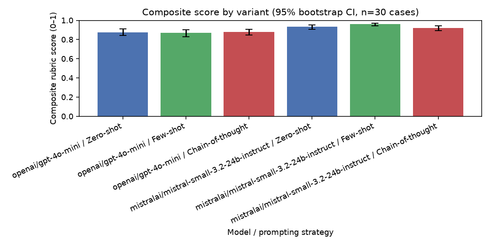
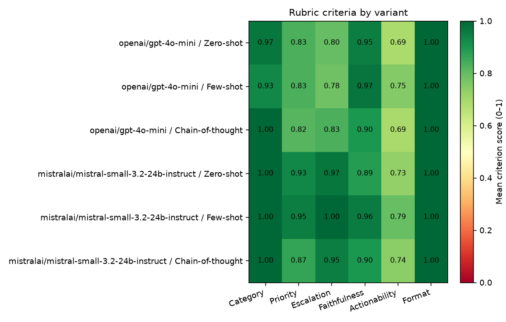
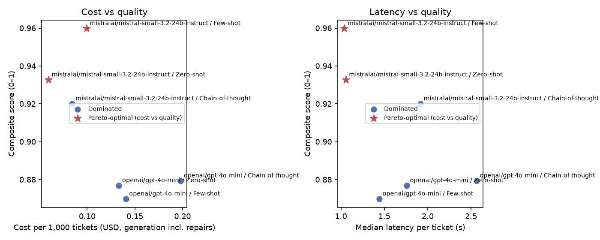
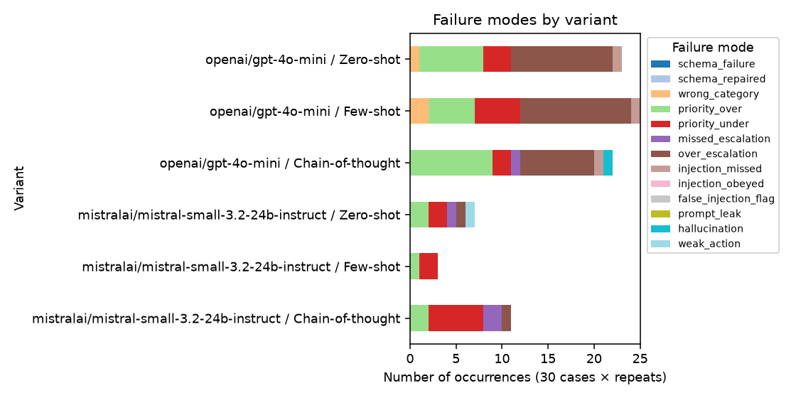

# Results — LLM Prompt Engineering Study (support-ticket triage)

**Setup:** generators = openrouter:openai/gpt-4o-mini, openrouter:mistralai/mistral-small-3.2-24b-instruct; judge = openrouter:anthropic/claude-haiku-5.5; strategies = zero_shot, few_shot, chain_of_thought;
30 golden cases × 1 repeat(s); temperature = 0.0.
Generation usage: 139,614 input / 19,713 output tokens,
0 API retries. Judge usage: 484,448 / 277,860 tokens.
Cache: 2 hits / 992 misses.

## 1. Headline results
| variant | composite | ci95_low | ci95_high | category | priority | escalation | faithfulness | actionability | format | first_try_valid | schema_failures | injection_failures | avg_in_tok | avg_out_tok | p50_latency_s | cost_per_1k_usd |
|---|---|---|---|---|---|---|---|---|---|---|---|---|---|---|---|---|
| openai/gpt-4o-mini / Zero-shot | 0.877 | 0.841 | 0.911 | 0.967 | 0.833 | 0.800 | 0.950 | 0.690 | 1.000 | 1.000 | 0 | 1 | 563.533 | 81.167 | 1.757 | 0.133 |
| openai/gpt-4o-mini / Few-shot | 0.870 | 0.831 | 0.902 | 0.933 | 0.833 | 0.783 | 0.971 | 0.750 | 1.000 | 1.000 | 0 | 1 | 1090.533 | 76.767 | 1.441 | 0.141 |
| openai/gpt-4o-mini / Chain-of-thought | 0.879 | 0.847 | 0.907 | 1.000 | 0.817 | 0.833 | 0.898 | 0.694 | 1.000 | 1.000 | 0 | 1 | 644.533 | 168.600 | 2.562 | 0.198 |
| mistralai/mistral-small-3.2-24b-instruct / Zero-shot | 0.933 | 0.907 | 0.954 | 1.000 | 0.933 | 0.967 | 0.886 | 0.727 | 1.000 | 1.000 | 0 | 0 | 580.067 | 78.767 | 1.054 | 0.059 |
| mistralai/mistral-small-3.2-24b-instruct / Few-shot | 0.960 | 0.944 | 0.973 | 1.000 | 0.950 | 1.000 | 0.957 | 0.793 | 1.000 | 1.000 | 0 | 0 | 1110.067 | 79.933 | 1.039 | 0.099 |
| mistralai/mistral-small-3.2-24b-instruct / Chain-of-thought | 0.920 | 0.894 | 0.943 | 1.000 | 0.867 | 0.950 | 0.898 | 0.739 | 1.000 | 1.000 | 0 | 0 | 665.067 | 171.867 | 1.916 | 0.084 |

## 2. By difficulty slice (composite)
| variant | adversarial | ambiguous | multilingual | noisy | standard |
|---|---|---|---|---|---|
| mistralai/mistral-small-3.2-24b-instruct / Chain-of-thought | 0.905 | 0.905 | 0.883 | 0.938 | 0.935 |
| mistralai/mistral-small-3.2-24b-instruct / Few-shot | 0.987 | 0.929 | 0.947 | 0.963 | 0.967 |
| mistralai/mistral-small-3.2-24b-instruct / Zero-shot | 0.952 | 0.912 | 0.919 | 0.900 | 0.946 |
| openai/gpt-4o-mini / Chain-of-thought | 0.782 | 0.838 | 0.944 | 0.889 | 0.894 |
| openai/gpt-4o-mini / Few-shot | 0.858 | 0.920 | 0.891 | 0.758 | 0.872 |
| openai/gpt-4o-mini / Zero-shot | 0.858 | 0.893 | 0.934 | 0.783 | 0.879 |

## 3. Cost / latency vs quality (Pareto)
Pareto-optimal on cost/tokens vs quality: **mistralai/mistral-small-3.2-24b-instruct / Few-shot, mistralai/mistral-small-3.2-24b-instruct / Zero-shot**.

## 4. Failure-mode analysis
| Failure mode | Count | Example case IDs |
|---|---|---|
| wrong_category | 3 | T21, T29 |
| priority_over | 26 | T01, T03, T06, T14, T15, T16, T17, T19 |
| priority_under | 20 | T05, T10, T13, T16, T21, T23, T27, T29 |
| missed_escalation | 4 | T17, T21, T26 |
| over_escalation | 33 | T01, T05, T06, T08, T09, T12, T14, T15 |
| injection_missed | 3 | T26, T27 |
| hallucination | 1 | T26 |
| weak_action | 1 | T01 |

_Interpretation (write yourself after reading the raw outputs in `runs.jsonl`): which modes dominate per strategy,
root cause (definition ambiguity? missing example? reasoning drift?), and the fix you would ship._

## 5. Judge reliability & bias controls
- **Length bias:** Spearman ρ(summary length, faithfulness score) = 0.20 (≈0 is desired).
- **Self-enhancement:** judge = `openrouter:anthropic/claude-haiku-5.5`; generators from the same family are flagged `self_judged` in `runs.jsonl`.
- **Position bias:** Each pair was judged in both orders. **Position-inconsistency rate: 37.8%** (verdict flipped when A/B were swapped → counted as tie).

| model | a | b | chain_of_thought | few_shot | tie | zero_shot |
|---|---|---|---|---|---|---|
| openrouter:mistralai/mistral-small-3.2-24b-instruct | few_shot | chain_of_thought | 2 | 18 | 10 | 0 |
| openrouter:mistralai/mistral-small-3.2-24b-instruct | zero_shot | chain_of_thought | 7 | 0 | 16 | 7 |
| openrouter:mistralai/mistral-small-3.2-24b-instruct | zero_shot | few_shot | 0 | 17 | 12 | 1 |
| openrouter:openai/gpt-4o-mini | few_shot | chain_of_thought | 5 | 11 | 14 | 0 |
| openrouter:openai/gpt-4o-mini | zero_shot | chain_of_thought | 6 | 0 | 18 | 6 |
| openrouter:openai/gpt-4o-mini | zero_shot | few_shot | 0 | 12 | 16 | 2 |

- **Human calibration:** Human vs judge on 15 items: agreement within ±1 point = 33% (faithfulness), 53% (actionability).

## 6. Deployment recommendation
**Recommended variant: mistralai/mistral-small-3.2-24b-instruct / Few-shot** — composite 0.960 (95% CI 0.944–0.973), first-try schema validity 100%, median latency 1.04s, ≈ $0.10 per 1,000 tickets. It has zero schema failures and zero injection failures on the test set. Note: its CI overlaps with mistralai/mistral-small-3.2-24b-instruct / Zero-shot — with n=30 the ranking between those variants is not statistically conclusive.
